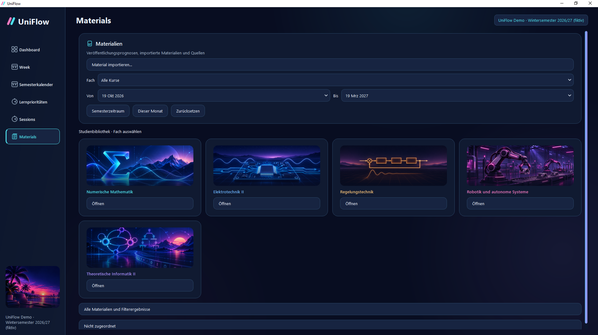
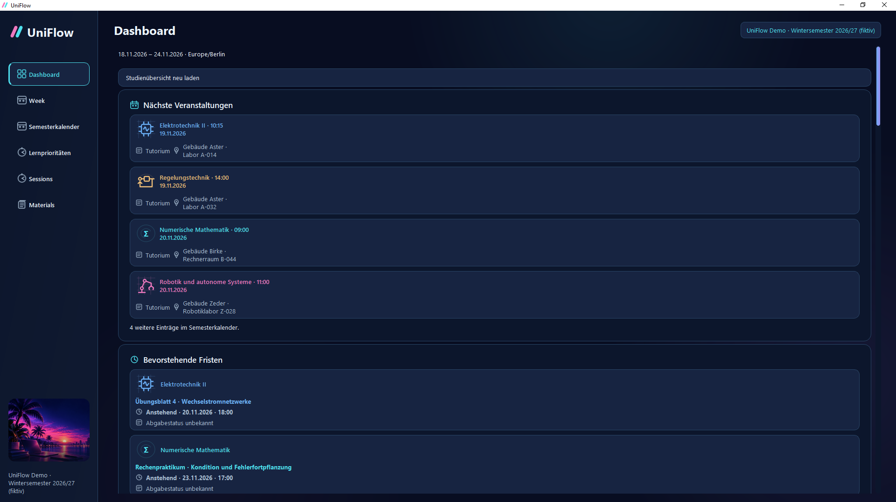
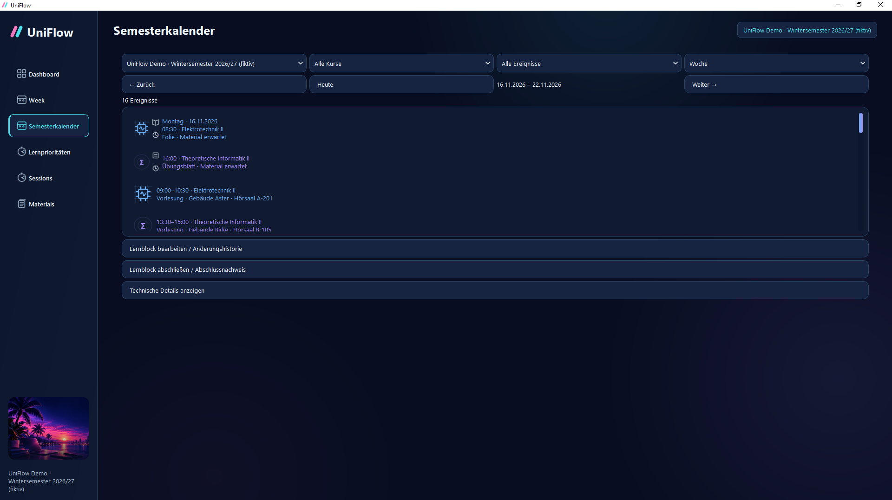
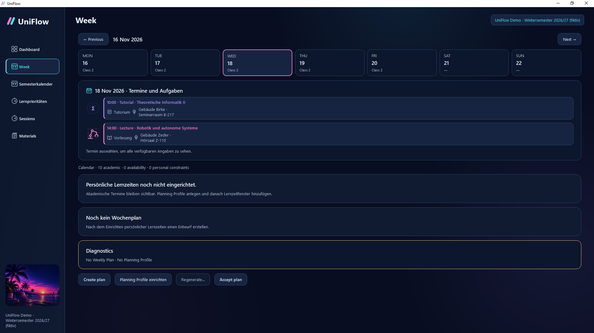

# UniFlow

UniFlow is a local-first desktop app for planning a university semester, organizing course materials, and managing learning sessions. A structured semester file brings courses, recurring classes, deadlines, and expected materials into one workspace. Each project has its own SQLite database.



## Features

- **Semester import** — Import YAML or JSON, preview proposed changes in a dry run, and retain the original file and revision after a successful import.
- **Dashboard and calendar** — See upcoming classes, deadlines, and expected material releases. Filter semester events by course and event type.
- **Material library** — Browse materials by course, import local PDFs, and extract their text for use in the app.
- **Learning sessions** — Export structured learning handoffs, import supported result files, and explicitly confirm session completion.
- **Course visuals** — Recognize subjects across the dashboard, calendar, and material library through shared colors, icons, and artwork.

## Try the demo on Windows

Open PowerShell in the repository root. Use Python 3.14 x64. The Windows V1 build was verified with Python 3.14.6 and the dependency versions in [the Windows lock file](packaging/windows/requirements-lock.txt).

```powershell
py -3.14 -m venv .venv
$python = Join-Path $PWD '.venv\Scripts\python.exe'
$cli = Join-Path $PWD '.venv\Scripts\uniflow.exe'
& $python -m pip install -r packaging/windows/requirements-lock.txt
& $python -m pip install --no-deps -e .
```

Create an isolated project and import [the fictional semester](examples/example.yaml). The example contains five modules, ten recurring classes, five deadlines, and five material release rules.

```powershell
$demo = Join-Path $env:TEMP ("uniflow-demo-" + [guid]::NewGuid().ToString('N'))
$config = Join-Path $demo 'config\default.yaml'
New-Item -ItemType Directory -Path (Split-Path -Parent $config) -Force | Out-Null
Copy-Item -LiteralPath 'config\default.yaml' -Destination $config
& $cli init --project-root $demo --config $config
& $cli audit-import 'examples\example.yaml' --dry-run --project-root $demo --config $config
```

If the dry run reports `READY`, apply the import and open the desktop app.

```powershell
& $cli audit-import 'examples\example.yaml' --project-root $demo --config $config
& $python -m uniflow.gui --project-root $demo
```

Select **16–22 November 2026** in the semester calendar to see a representative week. The dashboard's upcoming items are calculated relative to the current date.

## Screenshots

| Dashboard | Semester calendar |
| --- | --- |
|  |  |

### Week view

Select a day in the weekly strip to see its classes, start times, and rooms.



## Architecture

| Layer | Role |
| --- | --- |
| [Desktop UI](src/uniflow/gui/) | PySide6 screens, read-model presentation, and reusable course visuals |
| [Application](src/uniflow/application/) | Use cases such as semester import and calendar construction |
| [Schemas](src/uniflow/schemas/) | Pydantic models for validated import and exchange formats |
| [Persistence](src/uniflow/infrastructure/database/) | SQLAlchemy and SQLite, with versioned Alembic migrations |

The [semester import service](src/uniflow/application/audit_import.py) is a starting point for reading the code. It validates the input against the [semester audit schema](src/uniflow/schemas/semester_audit.py), builds an import plan, and applies accepted changes in a transaction. Equivalent YAML or JSON inputs share a canonical content hash. Replaying an already imported audit returns `ALREADY_IMPORTED`. See the [import design notes](docs/semester_audit_import.md) for revision handling and conflict resolution.

The [course visual resolver](src/uniflow/gui/visual_identity.py) assigns each recognized subject a banner, accent, and icon. The UI reuses those choices across views.

## Tests

With the environment above, run the focused import and calendar tests from the repository root.

```powershell
& $python -m pytest tests/test_audit_import.py tests/test_semester_calendar.py -q
```

## Build the Windows app

Run the [Windows build script](packaging/windows/build.ps1) from the repository root with a Python 3.14 x64 interpreter. Set the example interpreter path to match your installation.

```powershell
& .\packaging\windows\build.ps1 -Python 'C:\Path\To\Python314\python.exe'
```

PyInstaller writes the application to `dist/UniFlow/`. Keep `UniFlow.exe` and its `_internal` directory together. To open the demo with the built app, pass the same project directory.

```powershell
& .\dist\UniFlow\UniFlow.exe --project-root $demo
```

## License

UniFlow V1 is licensed under the MIT License. See [LICENSE](LICENSE).
